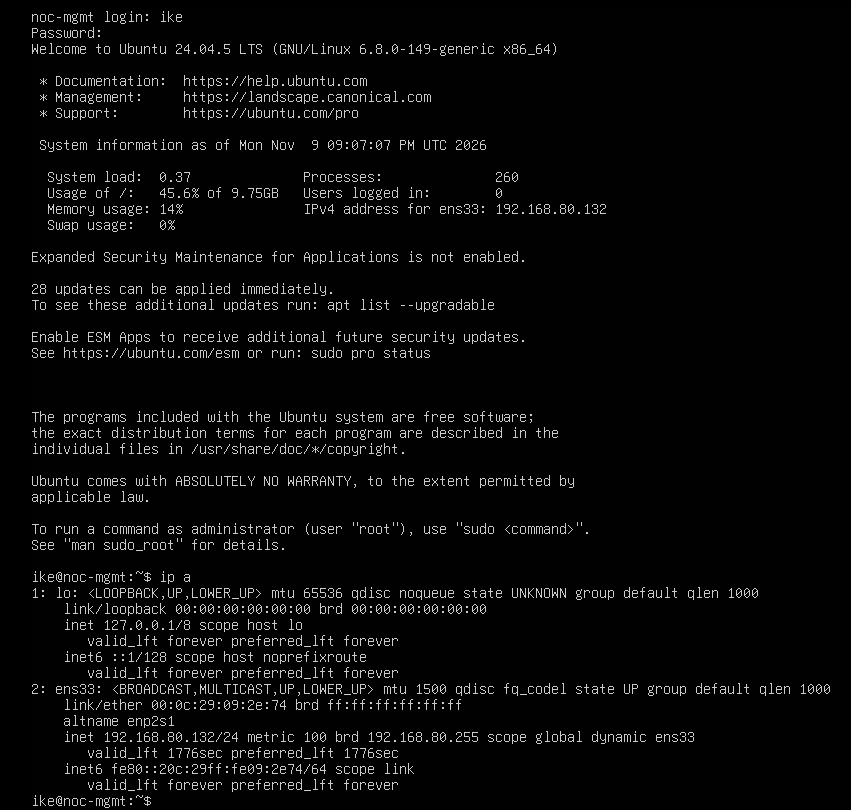
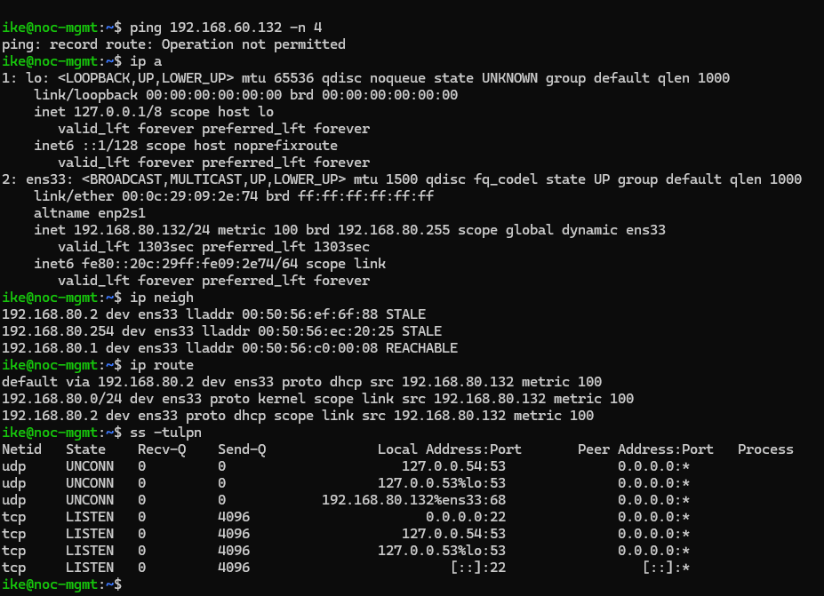
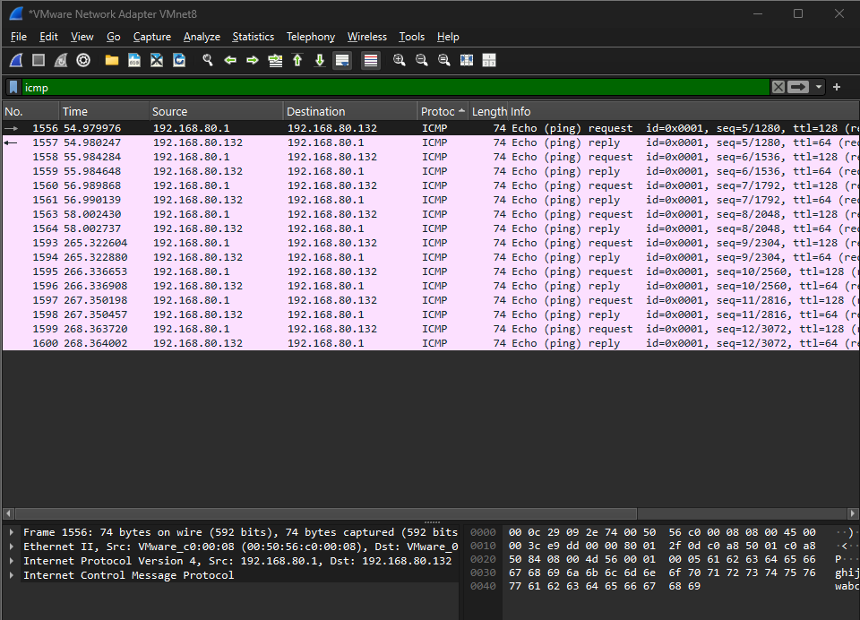
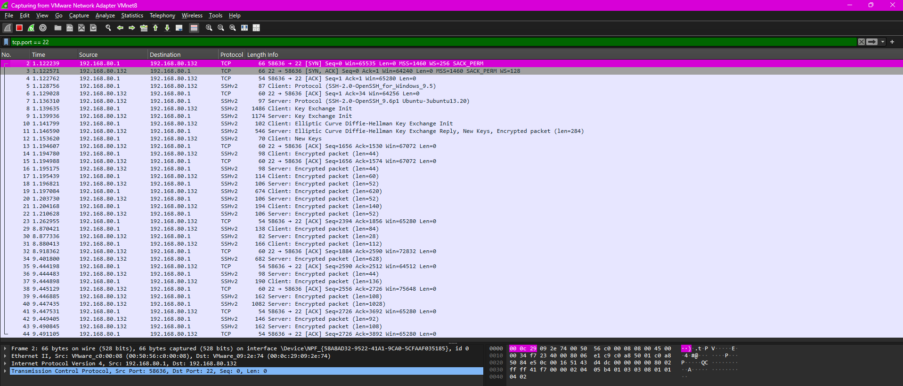
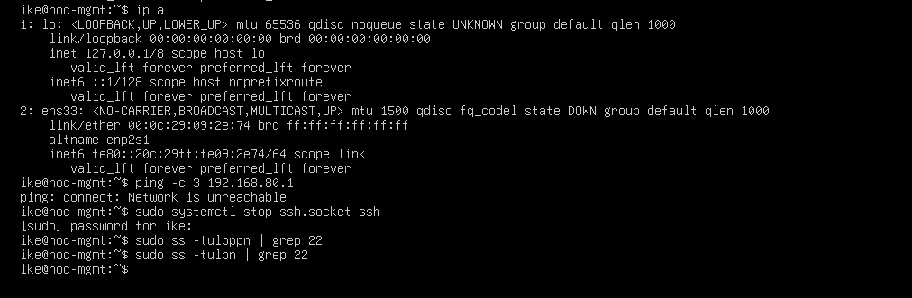
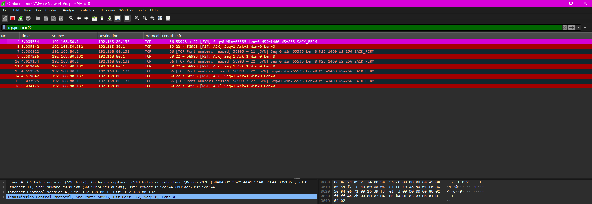
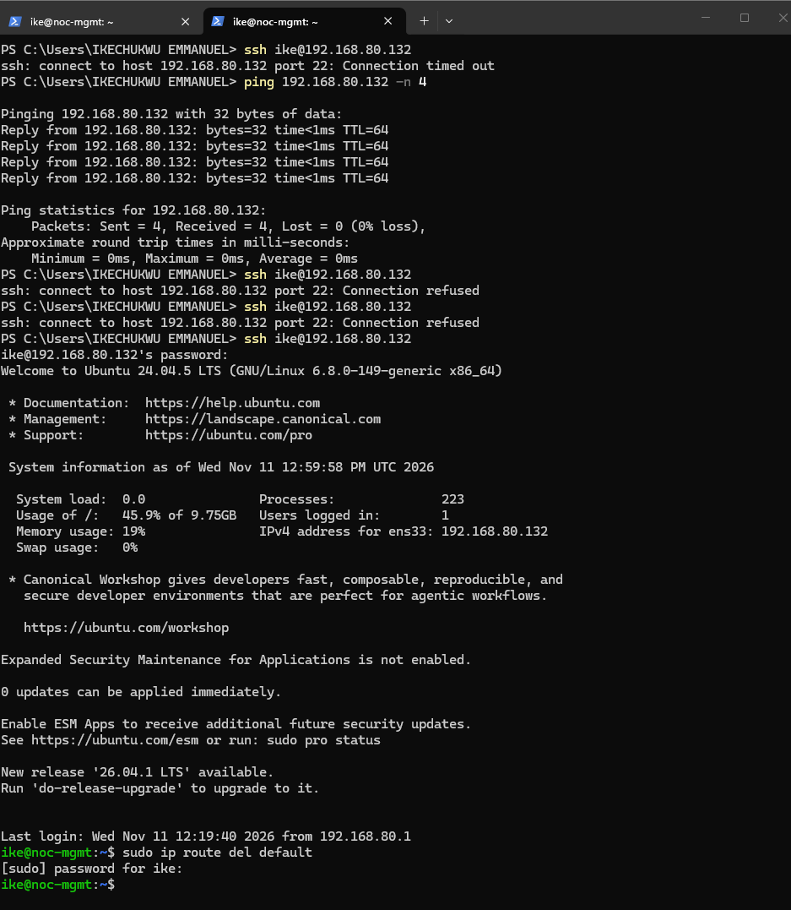
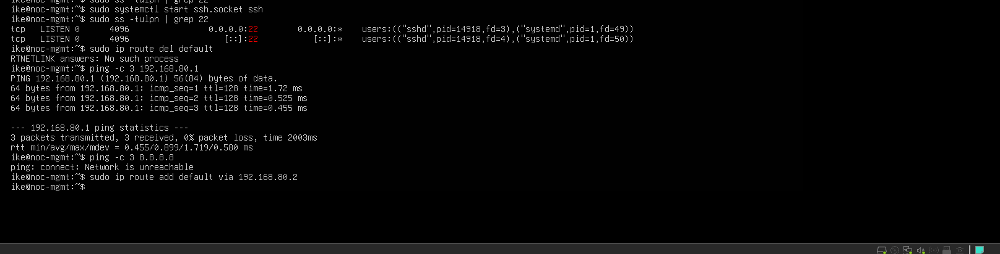

# Lab 01: Linux Server Networking and Troubleshooting Fingerprints

**Author:** Ikechukwu Emmanuel Chidiebere

**Part of:** [home-noc-lab](README.md), a home network operations centre (NOC) built to practise real NOC work

---

## 1. Summary

I built an Ubuntu Server virtual machine, managed it remotely over SSH like a NOC technician would, and captured its traffic in Wireshark. I then broke the server three times on purpose, at three different OSI layers, and recorded the exact symptoms, evidence and fix for each.

**Key outcome:** I can now tell the difference between a network fault and a service fault from the error message alone:

| Error | Meaning | Where to look |
| --- | --- | --- |
| `Connection timed out` | Nothing answered. The packet was lost or dropped. | Network: cable, IP, route, firewall |
| `Connection refused` | The server answered "no". Nothing is listening on that port. | Service: is it running? |
| `Network is unreachable` | The server has no route to the destination | Routing table and IP configuration |

---

## 2. Lab environment

| Item | Detail |
| --- | --- |
| Host | HP EliteBook 840 G5, Intel i5-8350U (4 cores / 8 threads), 20 GB RAM, Windows 11 Pro |
| Hypervisor | VMware Workstation Pro |
| VM | `noc-mgmt-01`: Ubuntu Server 24.04.5 LTS, 2 vCPU, 2 GB RAM, 25 GB disk |
| VM network | VMware NAT (VMnet8), `192.168.80.0/24` |
| VM IP | `192.168.80.132/24` (assigned by DHCP) |
| Default gateway | `192.168.80.2` (VMware NAT gateway) |
| Windows host on VMnet8 | `192.168.80.1` |
| Tools | OpenSSH, Wireshark + Npcap, Windows PowerShell |

**Network diagram**

```
 [Windows 11 laptop]                         [noc-mgmt-01 (Ubuntu VM)]
  192.168.80.1  ----------- VMnet8 ----------  192.168.80.132/24
                               |
                    [VMware NAT gateway 192.168.80.2] ---> Internet
                    [VMware DHCP server 192.168.80.254]
```

---

## 3. Build steps

1. Downloaded the Ubuntu Server 24.04.5 ISO and created a new VM in VMware (Typical setup, Ubuntu 64-bit, 2 GB RAM, 2 CPUs, 25 GB disk, NAT network adapter).
2. Installed Ubuntu Server with the **OpenSSH server** option selected.
3. Updated the server:
   ```bash
   sudo apt update && sudo apt upgrade -y
   ```
4. Confirmed SSH was running:
   ```bash
   sudo systemctl status ssh
   ```
5. Connected from Windows PowerShell:
   ```powershell
   ping 192.168.80.132
   ssh ike@192.168.80.132
   ```



---

## 4. Baseline: what "healthy" looks like

Before breaking anything, I recorded the normal state of the server. In real NOC work this is the most important step: you can't spot "broken" without knowing "normal".

### 4.1 Interfaces: `ip a`

```
2: ens33: <BROADCAST,MULTICAST,UP,LOWER_UP> mtu 1500 qdisc fq_codel state UP
    link/ether 00:0c:29:09:2e:74 brd ff:ff:ff:ff:ff:ff
    inet 192.168.80.132/24 metric 100 brd 192.168.80.255 scope global dynamic ens33
```

| Field | Meaning | Healthy? |
| --- | --- | --- |
| `UP,LOWER_UP` / `state UP` | Interface is on and the (virtual) cable is connected | Yes |
| `00:0c:29:...` | MAC address. The `00:0c:29` prefix means a VMware network card | Yes |
| `inet 192.168.80.132/24` | IP address and subnet mask | Yes |
| `dynamic` | The address came from DHCP | Yes |
| `brd 192.168.80.255` | Broadcast address of the network | Yes |

`lo` (`127.0.0.1`) is the loopback interface: the machine talking to itself. It is always present.

### 4.2 Neighbours (ARP table): `ip neigh`

```
192.168.80.2   dev ens33 lladdr 00:50:56:ef:6f:88 STALE
192.168.80.254 dev ens33 lladdr 00:50:56:ec:20:25 STALE
192.168.80.1   dev ens33 lladdr 00:50:56:c0:00:08 REACHABLE
```

- `.1` is the Windows laptop, `.2` the NAT gateway, `.254` the DHCP server.
- **REACHABLE** means recently confirmed. **STALE** is normal: the entry is just not recently used.
- **Broken would look like** `FAILED` or `INCOMPLETE`, meaning the device does not answer at layer 2.

### 4.3 Routing table: `ip route`

```
default via 192.168.80.2 dev ens33 proto dhcp src 192.168.80.132 metric 100
192.168.80.0/24 dev ens33 proto kernel scope link src 192.168.80.132 metric 100
192.168.80.2 dev ens33 proto dhcp scope link src 192.168.80.132 metric 100
```

- `default via 192.168.80.2`: any destination not on the local network (e.g. the internet) is sent to the gateway.
- `192.168.80.0/24 ... scope link`: the local network is reached directly, without a gateway.
- **Broken would look like** no `default` line: local traffic works but the internet does not.

### 4.4 Listening ports: `sudo ss -tulpn`

```
udp  UNCONN  127.0.0.54:53            0.0.0.0:*
udp  UNCONN  127.0.0.53%lo:53         0.0.0.0:*
udp  UNCONN  192.168.80.132%ens33:68  0.0.0.0:*
tcp  LISTEN  0.0.0.0:22               0.0.0.0:*
tcp  LISTEN  127.0.0.54:53            0.0.0.0:*
tcp  LISTEN  127.0.0.53%lo:53         0.0.0.0:*
tcp  LISTEN  [::]:22                  [::]:*
```

| Entry | Meaning |
| --- | --- |
| `0.0.0.0:22` / `[::]:22` LISTEN | SSH accepting connections on all IPv4 and IPv6 addresses |
| `127.0.0.53:53`, `127.0.0.54:53` | Ubuntu's local DNS resolver (systemd-resolved), localhost only |
| UDP `:68` | DHCP client keeping the IP lease |

**Broken would look like** an expected port missing (service down), or a service bound only to `127.0.0.1` when it should be reachable from other machines.



### 4.5 Baseline traffic in Wireshark

**ICMP (ping) from Windows to the VM**, filter `icmp`:

- Every **Echo (ping) request** from `192.168.80.1` had a matching **Echo (ping) reply** from `192.168.80.132`.
- Requests had **TTL=128**, replies **TTL=64**. Windows starts TTL at 128 and Linux at 64, so TTL gives a clue about the operating system on the other end.



**A healthy SSH login**, filter `tcp.port == 22`:

| Packets | What happened |
| --- | --- |
| `SYN` → `SYN, ACK` → `ACK` | TCP three-way handshake: the connection is set up |
| `SSH-2.0-OpenSSH_for_Windows_9.5` / `SSH-2.0-OpenSSH_9.6p1 Ubuntu-3ubuntu13.20` | Client and server version banners, sent **in plain text** |
| Key Exchange Init, Elliptic Curve Diffie-Hellman, New Keys | Both sides agree on encryption keys |
| `Encrypted packet` | Everything after this is unreadable in Wireshark |

**Security note:** the version banners are visible before encryption starts. Attackers scan for these banners to find vulnerable SSH versions, which is one reason to keep servers patched.



---

## 5. Fault simulations

### Break 1: Network adapter disconnected (OSI layer 1)

**Simulation:** VMware → VM Settings → Network Adapter → untick **Connected**.

**Evidence:**

```
ike@noc-mgmt:~$ ip a
2: ens33: <NO-CARRIER,BROADCAST,MULTICAST,UP> mtu 1500 qdisc fq_codel state DOWN
    link/ether 00:0c:29:09:2e:74 brd ff:ff:ff:ff:ff:ff
    inet6 fe80::20c:29ff:fe09:2e74/64 scope link

ike@noc-mgmt:~$ ping -c 3 192.168.80.1
ping: connect: Network is unreachable
```

From Windows:

```
PS> ssh ike@192.168.80.132
ssh: connect to host 192.168.80.132 port 22: Connection timed out
```

**Analysis:**

- `NO-CARRIER` and `state DOWN`: no physical signal. `LOWER_UP` has disappeared.
- The `inet` (IPv4) line is gone: without a link, the DHCP address was lost.
- `Network is unreachable`: with no IP, the server has no route to anywhere.
- `Connection timed out` from Windows: the SSH request got **no answer at all**.

**Fix:** reconnected the network adapter in VMware. `ip a` showed `state UP` and the IP returned.

**Real-world equivalent:** a cut fibre or unplugged cable, like a provider uplink going down in a NOC.



---

### Break 2: SSH service stopped (OSI layers 4 and 7)

**Simulation:**

```bash
sudo systemctl stop ssh.socket ssh
sudo ss -tulpn | grep 22      # returned nothing: port 22 no longer listening
```

**Evidence:** ping still worked from Windows, but SSH was refused:

```
PS> ping 192.168.80.132 -n 4
Reply from 192.168.80.132: bytes=32 time<1ms TTL=64   (4/4 received, 0% loss)

PS> ssh ike@192.168.80.132
ssh: connect to host 192.168.80.132 port 22: Connection refused
```

In Wireshark (filter `tcp.port == 22`), each attempt showed:

```
192.168.80.1   -> 192.168.80.132  TCP  58993 -> 22 [SYN]
192.168.80.132 -> 192.168.80.1    TCP  22 -> 58993 [RST, ACK]
```

**Analysis:**

- Ping working proves layers 1–3 are healthy: link, switching and IP routing all work.
- The server replied to the SSH request with `RST, ACK` (reset). That is the server actively saying "nothing is listening on this port".
- **`RST` in Wireshark = `Connection refused` on the command line.**

**Fix:**

```bash
sudo systemctl start ssh.socket ssh
sudo ss -tulpn | grep 22
tcp LISTEN 0 4096 0.0.0.0:22 0.0.0.0:* users:(("sshd",pid=14918,fd=3),("systemd",pid=1,fd=49))
tcp LISTEN 0 4096    [::]:22    [::]:* users:(("sshd",pid=14918,fd=4),("systemd",pid=1,fd=50))
```

SSH from Windows then connected successfully.

**Real-world equivalent:** a crashed or stopped application or web server while the network is fine. A NOC technician checks the service, not the network.




---

### Break 3: Default gateway route removed (OSI layer 3)

**Simulation:**

```bash
sudo ip route del default
```

**Evidence:**

```
ike@noc-mgmt:~$ ping -c 3 192.168.80.1
64 bytes from 192.168.80.1: icmp_seq=1 ttl=128 time=1.72 ms
64 bytes from 192.168.80.1: icmp_seq=2 ttl=128 time=0.525 ms
64 bytes from 192.168.80.1: icmp_seq=3 ttl=128 time=0.455 ms
3 packets transmitted, 3 received, 0% packet loss

ike@noc-mgmt:~$ ping -c 3 8.8.8.8
ping: connect: Network is unreachable
```

**Analysis:**

- `192.168.80.1` is on the **same /24 network**, so it is reached directly without a gateway. Ping succeeded (`ttl=128` shows a Windows machine answered).
- `8.8.8.8` is **outside** the local network and needs the default route. With no route, Linux refused to send the packet: `Network is unreachable`.
- My SSH session from Windows **stayed connected** throughout, because the laptop is on the same network and never uses the gateway.
- The gateway device itself was still working. The server had only lost its **route** to it. This is a configuration fault, not a device fault.
- Running the delete command a second time returned `RTNETLINK answers: No such process`, confirming the route was already gone.

**Fix:**

```bash
sudo ip route add default via 192.168.80.2
```

**Real-world equivalent:** a missing or wrong static route after a change. Local services keep working while internet or remote-site access fails, a classic "half-working" incident.



---

## 6. Troubleshooting method: bottom-up through the OSI model

| Layer | What it is | Symptom when broken | Check with |
| --- | --- | --- | --- |
| 1 Physical | Cable, fibre, signal | `NO-CARRIER`, link down | `ip a` |
| 2 Data link | MAC addresses, switches, VLANs | ARP `FAILED` / `INCOMPLETE` | `ip neigh` |
| 3 Network | IP addressing and routing | `Network is unreachable`, 169.254.x.x address | `ping`, `ip route`, `traceroute` |
| 4 Transport | TCP/UDP ports | `Connection refused`, `RST` packets, timeouts from firewalls | `ss -tulpn`, Wireshark |
| 7 Application | SSH, DNS, HTTP | Service inactive or failed | `systemctl status`, `nslookup`, `curl` |

**Rule I follow:** if ping works, layers 1–3 are fine. Move up to ports and services.

---

## 7. Subnetting practice

| Question | Answer | Working |
| --- | --- | --- |
| Network address of `192.168.80.132/24` | `192.168.80.0` | Host part (last octet) set to 0 |
| Are `192.168.1.10/24` and `192.168.2.10/24` on the same network? | No | The third octet differs, so a router is needed |
| Is `192.168.80.200/24` on the same network as the VM? | Yes | The first three octets match (`192.168.80`) |
| Usable hosts in a `/24` | 254 | 2⁸ = 256 − 2 (network + broadcast) |
| Usable hosts in a `/25` | 126 | 2⁷ = 128 − 2 |
| Usable hosts in a `/26` | 62 | 2⁶ = 64 − 2 |
| Network address of `10.10.5.77/24` | `10.10.5.0` | Host part set to 0 |
| What does `169.254.x.x` mean? | DHCP failed | The device gave itself an APIPA address |

**Formula:** usable hosts = 2^(32 − prefix) − 2

---

## 8. Lessons learned

1. **Record a baseline first.** "Broken" is only obvious when you know what "normal" looks like.
2. **Timed out ≠ refused.** Timed out points at the network; refused points at the service.
3. **Ping proves layers 1–3.** If ping works and the application doesn't, look at ports and services.
4. **Wireshark shows the truth.** An `RST` packet is the server refusing; no reply at all is a lost or dropped packet.
5. **Read the whole Wireshark window.** "Packets: 11 · Displayed: 0" meant the capture was working but my filter matched nothing, because I started the capture after the traffic happened.
6. **Check commands before pressing Enter.** I typed `ping 192.168.60.132 -n 4` on Linux: a wrong subnet *and* Windows syntax. Linux uses `ping -c 4`.
7. **Work from the console when breaking networking**, so you don't cut off your own remote session.

---

## 9. Command reference

| Command | Purpose |
| --- | --- |
| `ip a` | Show interfaces, link state and IP addresses |
| `ip neigh` | Show the ARP table (IP to MAC) |
| `ip route` | Show the routing table |
| `sudo ss -tulpn` | Show listening ports and the processes that own them |
| `systemctl status / start / stop <service>` | Check or control a service |
| `ping -c 4 <ip>` | Test reachability (Linux) |
| `ping <ip> -n 4` | Test reachability (Windows) |
| `sudo ip route del default` / `sudo ip route add default via <gw>` | Remove or add the default route |
| Wireshark `icmp`, `tcp.port == 22` | Display filters for ping and SSH traffic |

---
